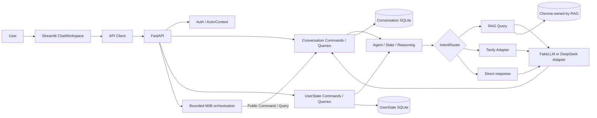

# Deutschpath Unified Agent

**[简体中文](README.md) | English (current)**

**v0.2.1 — A modular German-learning assistant**

Deutschpath Unified Agent brings German-learning chat, learner profiles, personal document retrieval, and auditable session operations into a locally runnable application. Each business module owns its rules and data and cooperates through stable Command / Query / DTO contracts.

> v0.2.1 is a local integration stability release. It is not a public production release and does not represent v1.0.0 acceptance.

## Product capabilities

- Chat through a Streamlit workspace backed by FastAPI, with persistent sessions and message history.
- Maintain CEFR levels, learning goals, preferences, and learning events.
- Upload TXT, MD, PDF, and DOCX materials for session-scoped retrieval through Parser, RAG, and Chroma.
- Route requests across `rag`, `web_search`, and `no_tool`; live web search requires Tavily configuration and has not passed release-environment connectivity acceptance.
- Isolate OCR and database tools through MCP; review results and explicitly confirm writes.
- M08 supports one bounded workflow: `rename_session → get_session` verification, optionally followed by `list_sessions`. It supports clarification, confirmation, duplicate-confirmation protection, and restart recovery; it is not a general-purpose planner.
- M09 optionally offers up to three follow-up questions. It is off by default; clicking only prefills the input and never submits or writes automatically.
- Auth contains OIDC access-token verification boundaries; a real identity provider and public two-user isolation remain unverified.

## Architecture



External consumers use public module contracts. ORM, repositories, SQL, and transactions stay inside their owning module. M08 owns orchestration state and calls Conversation Commands / Queries for business operations. Separate SQLite files do not provide a distributed transaction.

## M01–M10 evolution

| Milestone | Capability and problem addressed | Actual boundary |
|---|---|---|
| M01 | Unified Agent, LLM clients, FakeLLM, State/Reasoning/Action boundaries | Offline path is testable; live models are configured separately |
| M02 | SQLite learner profile, CEFR, goals, and learning events | UserState owns its state |
| M03 | Streamlit, FastAPI, sessions, and chat history | Local API/UI integration |
| M04 | File parsing and session-scoped RAG | TXT, MD, PDF, DOCX; RAG owns vector data |
| M05 | `rag` / `web_search` / `no_tool` routing and evidence aggregation | Independent human evaluation of 150 Router cases is incomplete |
| M06 | MCP OCR/database tools and confirmed writes | MCP Inspector GUI is unverified |
| M07 | Conversation Commands/Queries, bounded context, and restart recovery | Public OIDC isolation is unverified |
| M08 | Clarification, confirmation, real session rename, fixed two-step orchestration | `rename_session → list_sessions`; not a general planner |
| M09 | Optional read-only follow-up suggestions | Up to three; prefills only, never executes |
| M10 | Integration regression, Auth boundary, and deployment drafts | Real OIDC, public deployment, and container recovery are unverified |

See the [M01–M10 iteration manifest](docs/iterations/manifest.json) for contracts, implementation notes, and test evidence.

## Technology stack

| Component | Role and status |
|---|---|
| Python 3.14 | Required by `pyproject.toml`: `>=3.14,<3.15` |
| FastAPI + Uvicorn | API, request DTOs, and application composition |
| Streamlit | Chat workspace, learner profile, and version center |
| SQLite | Module-owned Conversation, UserState, M08 persistence; designed for one local instance |
| ChromaDB | Vector index owned by RAG |
| DeepSeek Adapter / FakeLLM | Optional hosted provider / offline-safe path |
| Tavily Adapter | Optional web search; a configured key does not prove connectivity |
| MCP SDK 1.30.0, RapidOCR 3.10.0 | stdio tools and OCR |
| Docker Compose, Caddy | Deployment templates; public deployment has not been accepted |

Dependency ranges are in [`pyproject.toml`](pyproject.toml); see [technology notes](docs/TECH_STACK.md).

## Windows quick start

Requirements: Windows PowerShell and Python 3.14. Run from the repository root:

```powershell
py -3.14 -m venv .venv
.\.venv\Scripts\python.exe -m pip install --upgrade pip
.\.venv\Scripts\python.exe -m pip install -e ".[dev]"
Copy-Item .env.example .env
```

Start with the project defaults:

```powershell
.\scripts\start_app.ps1
```

FastAPI defaults to `http://127.0.0.1:8765`; Streamlit defaults to `http://127.0.0.1:8501`. The launcher checks process identity and health and will not terminate or silently reuse an unrecognized process. Stop each service with `Ctrl+C` in its own window.

### Isolated demo mode

```powershell
.\scripts\start_app.ps1 -DemoMode
```

DemoMode binds only to `127.0.0.1`, defaults to ports 18765/18501, and stores data at `%LOCALAPPDATA%\DeutschpathUnifiedAgent\demo-v0.2.1`. It enables development mode and bounded M08, uses FakeLLM, Rules Router, deterministic embeddings, and clears inherited DeepSeek/Tavily keys for child processes. Demo data persists between runs. This does not change authentication policy and must not be used as a public deployment.

## Tests and quality

```powershell
.\scripts\run_tests.ps1
& .\.venv\Scripts\python.exe -m pytest -q tests/integration/test_api_smoke.py
& .\.venv\Scripts\python.exe -m compileall -q app ui scripts tests
git diff --check
```

`run_tests.ps1` excludes API Smoke by design; report both results separately. Isolated M08 HTTP acceptance:

```powershell
& .\.venv\Scripts\python.exe scripts/m08_b_http_acceptance.py
& .\.venv\Scripts\python.exe scripts/m08_c_http_acceptance.py
```

The PowerShell 7 and Windows PowerShell 5.1 full scripts both report **276 passed, 1 skipped, 0 failed**; the only skip is an OCR symlink fixture unavailable to this Windows account. Standalone API Smoke reports **1 passed**. Isolated loopback HTTP acceptance for M08-B/M08-C, M09, and MCP B6 also passed. Compileall, bilingual README link checks, and Manifest path checks passed. Real browser visual acceptance was completed, but its screenshot image could not be saved in the repository. See the [v0.2.1 release record](docs/releases/v0.2.1.md) and [demo guide](docs/demo/README.md).

## v0.2.1 changes

- Fixed Chinese word-order variants in M08 rename recognition and verified the real session title through Conversation Query.
- Preserved the public M08 orchestration DTO in the UI client and refreshed the title without resubmitting a write request.
- Added isolated DemoMode and UTF-8 encoding compatibility for the PowerShell test runner.
- Improved Chinese typography, chat reading width, and sidebar spacing.
- Added a Chinese primary README, a standalone English README, and version-center release notes.

See the [v0.2.1 release record](docs/releases/v0.2.1.md) and [changelog](docs/CHANGELOG.md).

## Limitations and v1.0 roadmap

- Real OIDC login, two-account API access, and isolation for all private resources remain to be tested publicly.
- DeepSeek and Tavily connectivity, cost controls, and limits have not been accepted in a real release environment.
- Router development data does not substitute for independently labeled and frozen evaluation of 150 cases.
- MCP Inspector GUI, actual Docker Compose/Caddy deployment, monitoring, and recovery drills are unverified.
- SQLite is currently intended for one local instance; evaluate migration based on measured concurrency needs.
- M08 covers a bounded session-management workflow only; it does not support general planning, arbitrary CRM writes, or arbitrary multi-tool execution.

## Documentation

- [Architecture](ARCHITECTURE.md) · [Module boundaries](docs/architecture/MODULE_BOUNDARIES.md) · [Public contracts](docs/architecture/PUBLIC_CONTRACTS.md)
- [Release scope](docs/V1_RELEASE_SCOPE.md) · [Release checklist](docs/RELEASE_CHECKLIST.md) · [Release blockers](docs/RELEASE_BLOCKERS.md)
- [M08 orchestration](docs/architecture/M08_ORCHESTRATION.md) · [M09 suggestions](docs/architecture/M09_SUGGESTIONS.md)
- [Demo and screenshot guide](docs/demo/README.md) · [M10 acceptance](docs/PHASE4_M10_ACCEPTANCE.md)
