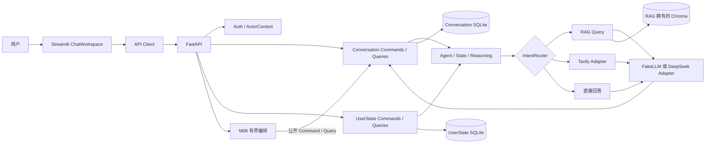

# Deutschpath Unified Agent

**简体中文（当前） | [English](README.en.md)**

**v0.2.1 — 模块化德语学习智能助手**

Deutschpath Unified Agent 将德语学习对话、学习者资料、个人文件检索和可审计的会话操作整合在一个可本机运行的应用中。每个业务模块拥有自己的规则与数据，通过稳定的 Command / Query / DTO 契约协作。

> v0.2.1 是本地集成稳定性版本。它不是已经通过公网生产验收的 v1.0.0。

## 产品能力

- 通过 Streamlit ChatWorkspace 与 FastAPI 进行对话，保存会话和消息，并恢复历史。
- 管理学习者 CEFR 等级、目标、偏好和学习记录。
- 上传 TXT、MD、PDF、DOCX，由 Parser、RAG 和 Chroma 检索与当前会话相关的材料。
- Router 在 `rag`、`web_search`、`no_tool` 三类路径中选择；联网能力需配置 Tavily，真实服务联通尚未验收。
- 通过 MCP 隔离 OCR 与数据库工具；写入前显示可审核结果并要求明确确认。
- M08 支持一个受限工作流：`rename_session → get_session` 核验，可选接续 `list_sessions`。包含缺参澄清、确认、重复确认保护和重启恢复；它不是通用任务规划器。
- M09 可选显示最多三条后续问题。默认关闭，点击只会预填输入框，不会自动发送或写入。
- Auth 模块支持 OIDC Access Token 验证的代码边界；真实身份提供方、公网双用户隔离尚未验收。

## 架构



外部消费者只调用所属模块的公开接口；ORM、Repository、SQL 和事务留在模块内部。M08 只拥有编排状态，通过 Conversation Command / Query 执行业务。跨模块 SQLite 不构成分布式事务。

## M01–M10 演进

| 更新 | 产品能力与问题 | 真实边界 |
|---|---|---|
| M01 | 统一 Agent、LLM Client、FakeLLM 与 State/Reasoning/Action 边界 | 离线路径可测；真实模型另行配置 |
| M02 | SQLite 学习者画像、CEFR、目标和学习事件 | UserState 模块拥有自己的状态 |
| M03 | Streamlit、FastAPI、会话和聊天历史 | 本机 API/UI 集成 |
| M04 | 文件解析和会话隔离 RAG | TXT、MD、PDF、DOCX；向量数据由 RAG 管理 |
| M05 | `rag` / `web_search` / `no_tool` 路由和证据聚合 | Router 独立人工 150 题评估未完成 |
| M06 | MCP OCR/数据库工具及人工确认写入 | MCP Inspector GUI 未验收 |
| M07 | Conversation Commands/Queries、受限上下文快照和重启恢复 | OIDC 公网隔离未验证 |
| M08 | 澄清、确认、真实会话重命名及固定双步骤编排 | `rename_session → list_sessions`，非通用 Planner |
| M09 | 可关闭的只读后续问题建议 | 最多三条；只预填，不执行 |
| M10 | 集成回归、Auth 边界与生产部署草案 | 真实 OIDC、公网、容器恢复未验收 |

各阶段接口、问题和测试详情见 [M01–M10 演进记录](docs/iterations/manifest.json)。

## 技术栈

| 组件 | 用途与状态 |
|---|---|
| Python 3.14 | `pyproject.toml` 要求 `>=3.14,<3.15` |
| FastAPI + Uvicorn | API、请求 DTO 与应用装配 |
| Streamlit | ChatWorkspace、学习者资料和版本中心 |
| SQLite | Conversation、UserState、M08 等模块内持久化；当前按本机单实例设计 |
| ChromaDB | RAG 向量索引 |
| DeepSeek Adapter / FakeLLM | 可选在线 Provider / 离线安全路径 |
| Tavily Adapter | 可选 Web Search；Key 存在不代表已连通 |
| MCP SDK 1.30.0、RapidOCR 3.10.0 | stdio 工具协议与 OCR |
| Docker Compose、Caddy | 部署模板；尚未完成真实公网部署验收 |

依赖版本范围见 [pyproject.toml](pyproject.toml)，技术栈说明见 [docs/TECH_STACK.md](docs/TECH_STACK.md)。

## Windows 本地启动

需要 Windows PowerShell 和 Python 3.14。在仓库根目录执行：

```powershell
py -3.14 -m venv .venv
.\.venv\Scripts\python.exe -m pip install --upgrade pip
.\.venv\Scripts\python.exe -m pip install -e ".[dev]"
Copy-Item .env.example .env
```

普通启动使用项目默认配置：

```powershell
.\scripts\start_app.ps1
```

API 默认在 `http://127.0.0.1:8765`，Streamlit 默认在 `http://127.0.0.1:8501`。启动器会核对服务进程与健康信息，不会终止或静默复用无法识别的进程。按各服务窗口中的提示使用 `Ctrl+C` 停止。

### 隔离演示模式

```powershell
.\scripts\start_app.ps1 -DemoMode
```

DemoMode 只绑定 `127.0.0.1`，默认使用端口 18765/18501，数据放在 `%LOCALAPPDATA%\DeutschpathUnifiedAgent\demo-v0.2.1`。它启用 development 环境和受限 M08，使用 FakeLLM、Rules Router、确定性 Embedding，并清空子进程中的 DeepSeek/Tavily Key。演示数据会在多次启动间保留。它不改变认证策略，也不能用于公网部署。

## 测试与质量

```powershell
.\scripts\run_tests.ps1
& .\.venv\Scripts\python.exe -m pytest -q tests/integration/test_api_smoke.py
& .\.venv\Scripts\python.exe -m compileall -q app ui scripts tests
git diff --check
```

`run_tests.ps1` 按原有约定排除 API Smoke；两项结果分开报告。M08 隔离 HTTP 验收：

```powershell
& .\.venv\Scripts\python.exe scripts/m08_b_http_acceptance.py
& .\.venv\Scripts\python.exe scripts/m08_c_http_acceptance.py
```

本轮 PowerShell 7 与 Windows PowerShell 5.1 全量脚本均为 **276 passed、1 skipped、0 failed**；唯一跳过项是该 Windows 账户无法创建 OCR symlink fixture。独立 API Smoke 为 **1 passed**。另外，M08-B/M08-C、M09 和 MCP B6 的隔离 loopback HTTP 验收均通过；compileall、双语 README 链接和 Manifest 路径检查通过。真实浏览器检查完成，但截图原图未能保存至仓库。完整说明见 [v0.2.1 更新记录](docs/releases/v0.2.1.md) 和 [演示指南](docs/demo/README.md)。

## v0.2.1 更新

- 修复 M08 中文重命名语序识别，并以 Conversation Query 读回真实会话标题。
- M08 返回的公开编排 DTO 在 UI 保留，操作完成后刷新标题，不重新提交写请求。
- 新增隔离 DemoMode，修复 PowerShell 测试脚本 UTF-8 编码兼容。
- 改善中文排版、聊天阅读宽度和侧栏层级。
- 提供中文主 README、英文独立 README 和版本中心更新记录。

详见 [v0.2.1 更新记录](docs/releases/v0.2.1.md) 和 [更新日志](docs/CHANGELOG.md)。

## 已知限制与 v1.0 路线

- 真实 OIDC 登录、双账户 API 访问及所有私人资源隔离仍待公网联调。
- DeepSeek、Tavily 在真实发布环境的连通性、成本与限流未验收。
- Router 开发集不能代替 150 题独立人工标注与冻结评估。
- MCP Inspector GUI、Docker Compose/Caddy 实际部署、监控和数据恢复演练未验收。
- SQLite 当前按单实例本机使用；并发负载提升后需基于数据评估迁移。
- M08 仅覆盖受限会话管理操作，不支持通用规划、任意 CRM 写入或任意多工具执行。

## 文档入口

- [架构总览](ARCHITECTURE.md) · [模块边界](docs/architecture/MODULE_BOUNDARIES.md) · [公开契约](docs/architecture/PUBLIC_CONTRACTS.md)
- [发布范围](docs/V1_RELEASE_SCOPE.md) · [发布清单](docs/RELEASE_CHECKLIST.md) · [发布阻塞项](docs/RELEASE_BLOCKERS.md)
- [M08 编排](docs/architecture/M08_ORCHESTRATION.md) · [M09 建议](docs/architecture/M09_SUGGESTIONS.md)
- [演示与截图指南](docs/demo/README.md) · [M10 验收](docs/PHASE4_M10_ACCEPTANCE.md)
