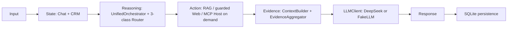

# Deutschpath Unified Agent v0.1.1.dev0

**LOCAL ENGINEERING BETA — development candidate, not a tagged release. Not
production ready.** The version is defined once in `pyproject.toml`; FastAPI
and Streamlit read it from `app/version.py`. The active application code lives
at this Git root. Historical project folders are preserved for recovery and
are not runtime dependencies.

## What is included

- FastAPI chat API and the recommended Streamlit chat interface.
- Persistent sessions, messages, user learning profiles, and learning events.
- TXT, Markdown, PDF, and DOCX parsing; direct attachment context and
  session-isolated Chroma RAG.
- Rule, LLM, and hybrid routing interfaces for `rag`, `web_search`, and
  `no_tool`; mixed local and web evidence is supported.
- Optional DeepSeek answer and routing provider; deterministic embeddings and
  `FakeLLM` allow offline testing. `FakeLLM` is not the DeepSeek service.
- Optional Tavily adapter and evidence aggregation. Real Tavily availability is
  not implied by configuration.
- Two real stdio MCP servers: restricted SQLite business database and RapidOCR
  image extraction. The Host discovers and calls tools, stages authorized
  images, requires explicit confirmation before writes, and verifies results.

## Architecture and maintenance

The actual request flow, data boundaries, and Router/MCP relationship are in
[`docs/ARCHITECTURE.md`](docs/ARCHITECTURE.md). Feature evidence is tracked in
[`docs/FEATURES.md`](docs/FEATURES.md), installed versions in
[`docs/TECH_STACK.md`](docs/TECH_STACK.md), and operational steps in
[`docs/DEBUGGING.md`](docs/DEBUGGING.md). Version notes are in
[`docs/CHANGELOG.md`](docs/CHANGELOG.md) and `docs/releases/`.

### Six engineering milestones (retrospective, not Git releases)

The technical evolution is recorded in [`docs/iterations/manifest.json`](docs/iterations/manifest.json):
[M01 Agent](docs/iterations/M01_agent_foundation.md) →
[M02 CRM](docs/iterations/M02_crm_state.md) →
[M03 Chat](docs/iterations/M03_chat_application.md) →
[M04 Files and RAG](docs/iterations/M04_file_rag.md) →
[M05 Router and Web](docs/iterations/M05_router_web.md) →
[M06 MCP Host](docs/iterations/M06_mcp_integration.md).
These IDs describe engineering evolution; only `pyproject.toml` defines the
application version, and `0.1.1.dev0` has no release tag.



The Stage 3 Router chooses `rag`, `web_search`, or `no_tool`; `mixed_sources`
is an evidence flag. MCP planning is a separate action path and does not add a
fourth Router intent.

- **日常启动：** 双击 `start.bat`
- **开发测试：** `scripts/run_tests.ps1`
- **维护与调试：** `docs/DEBUGGING.md`
- **版本更新记录：** `docs/CHANGELOG.md` 与 `docs/releases/`
- **GitHub 独立仓库发布准备：** `docs/releases/GITHUB_PUBLISH_CHECKLIST.md`（仅清单；当前无自动提交/推送）
- **技术演进时间线：** `docs/iterations/manifest.json` 与 M01–M06 记录
- Streamlit 的“系统信息 · 版本更新”显示当前版本、更新说明、功能状态和六个可展开的技术节点。
- **最近整理验收：** `docs/history/final-cleanup-20261013.md`

## Project layout

```text
app/       API, Agent, Chat, User State, LLM, routing, RAG, web, files, MCP
ui/        Streamlit application and API client
tests/     Unit, integration, protocol, AppTest, and public OCR fixtures
evals/     Router evaluation cases, annotation candidates, and metrics
scripts/   One-click coordinator, server launch, HTTP acceptance, evaluation
docs/      Architecture, feature status, stack, changelog, debugging, records
           iterations/ contains the controlled M01–M06 technical timeline
data/      Local runtime only; ignored by Git
start.bat  Recommended single launcher
```

The four historical working directories (`01_agent`, `02_crm_agent`,
`03_deutsch_chat`, and `04_stage2_unified_agent`) are not part of this active
project tree and are not runtime dependencies. Historical source and selected
legacy data protection are maintained outside the repository in the existing
archive/backup locations. The repository's `.git` history and index are kept
separate from that file archive; consult `docs/history/` before any Git
publication because this checkout originated from CRM-agent and retains
historical Git state.

## Setup and configuration

Use Python 3.14 (the project declares `>=3.14,<3.15`) and run from this Git
root. Install only the dependencies declared by the project:

```powershell
python -m venv .venv
.\.venv\Scripts\python.exe -m pip install -e ".[dev]"
```

You do not need to create or edit `.env` manually: the localhost API Settings
panel creates it from `.env.example` when the first key is saved. Never commit
`.env`. Process environment variables take precedence over `.env`.

| Setting | Purpose | Beta default |
| --- | --- | --- |
| `DEEPSEEK_API_KEY` | Optional DeepSeek answer / LLM-router calls | Empty; `FakeLLM` |
| `DEEPSEEK_BASE_URL`, `DEEPSEEK_MODEL` | DeepSeek endpoint and model | Official API / `deepseek-chat` |
| `TAVILY_API_KEY` | Optional live web search | Empty; real search not tested |
| `STAGE3_ROUTER` | `rules` or `hybrid` routing mode | `rules` |
| `STAGE2_EMBEDDING_PROVIDER` | `deterministic` or `e5` | `deterministic` |
| `STAGE2_DATA_PATH` | SQLite, Chroma, uploads, and MCP Host state root | `data/` |
| `MCP_DATABASE_PATH` | Optional separate MCP business SQLite file | `<data root>/mcp_business.sqlite3` |
| `DEUTSCHPATH_API_BASE_URL` | Streamlit backend API base URL | `http://127.0.0.1:8765` |
| `OCR_INPUT_DIR` | Dedicated input directory for standalone OCR server | Set by trusted MCP Host |

The Streamlit sidebar includes **API Settings** for this localhost-only beta.
Start it with `scripts/start_frontend.ps1`, which binds only to
`127.0.0.1`; the settings panel also rejects non-local Host headers. Keys are
entered as password fields and written atomically to the Git-ignored root
`.env`; existing unrelated settings are preserved. The app never returns or
pre-fills stored key values. Restart FastAPI after saving, then run the manual
DeepSeek or Tavily connection check from the panel. Process environment values
take precedence over `.env`, and the backend health response reports the source
and active provider/model without exposing credentials. This local beta panel
is not production-grade credential management. Do not expose Streamlit or the
API beyond localhost.

The OCR package uses bundled RapidOCR models; startup does not fetch model
weights. Choosing `e5` may require downloading/loading the sentence-transformer
model. The deterministic provider is the reproducible offline option.

## Run the application

From the project root, use the one recommended entry point:

```powershell
.\start.bat
```

It checks the active `.venv`, dependencies, the 8765/8501 listeners, API
identity and health, starts any missing service in its own PowerShell window,
checks Streamlit health, then opens the browser. It does not stop an existing
listener. If an older Deutschpath process owns a port, stop it with Ctrl+C in
its window and run `start.bat` again. Personal OS port 8000 is never used.

For manual diagnosis, open two PowerShell terminals:

```powershell
.\scripts\start_backend.ps1
.\scripts\start_frontend.ps1
```

The backend listens at `http://127.0.0.1:8765`; Streamlit at
`http://127.0.0.1:8501`. Both scripts validate the root `.venv`, Python
requirement, dependencies, and entry points. Press Ctrl+C to stop each process.
The application does not automatically migrate or overwrite a database.
The backend script checks that its selected port is available before launch and
fails without connecting to or stopping any service already using that port.
The one-click launcher delegates to these same PowerShell scripts and uses the
same project `.venv` and API base URL setting. Press Ctrl+C in each service
window to stop it (Streamlit first, then FastAPI).

For isolated HTTP acceptance, use a new data directory and a non-production
port. The MCP end-to-end acceptance script creates and removes its own temporary
data directory:

```powershell
.\.venv\Scripts\python.exe scripts\mcp_b6_http_acceptance.py
```

## Chat, files, RAG, and learning profile

Create a session, send messages, list sessions, and read history through the
FastAPI API. The Streamlit sidebar supports session switching and profile
updates. User state includes current/target CEFR level, learning goal,
preferences, and learning events; it is included in Agent context. Session
attachments are isolated by Chroma namespace. Small supported documents can be
placed directly into context; larger documents use session RAG.

The API identifies a local beta user using `X-User-ID`. This caller-supplied
header is **not authentication**. Bind to localhost and use only local test
identities; do not expose this service publicly.

## MCP and OCR-to-database workflow

The Host launches both MCP servers as local stdio subprocesses; there are no
MCP HTTP ports. The Database MCP exposes `db_create_table`, `db_insert_rows`,
and `db_query_readonly`, plus `db://schema` and the `ocr_to_db_workflow` prompt.
OCR MCP exposes `ocr_extract`. Database names and columns are constrained,
queries are read only, writes require a one-use Host approval after review, and
operation identifiers prevent replay. OCR images are staged by the trusted Host
inside its dedicated data root; arbitrary paths and URLs are not accepted.

The user reviews OCR-derived candidate rows before confirmation. Only confirmed
rows are written, then queried back; the result is stored in chat history. OCR
output is untrusted and table cells are candidates, not guaranteed structure.

## Tests and acceptance commands

日常开发使用统一入口运行非 TestClient 回归：

```powershell
.\scripts\run_tests.ps1
.\.venv\Scripts\python.exe -m compileall -q app ui scripts tests
.\.venv\Scripts\python.exe scripts\mcp_b6_http_acceptance.py
```

测试入口将 pytest 的数据库、Chroma 和 OCR 临时文件放入系统临时目录，成功或失败后自动清理。需要保留失败现场时，显式运行
`.\scripts\run_tests.ps1 -KeepFailedArtifacts`；失败目录会打印出来供诊断。
也可把额外 pytest 参数传给入口，例如：

```powershell
.\scripts\run_tests.ps1 -PytestArgs @('tests/integration/test_mcp_host_workflow.py')
```

The Windows TestClient smoke is separately marked BLOCKED and excluded; it is
not counted as passed. See `docs/CHANGELOG.md` and `docs/FEATURES.md` for the
current worktree status, plus `docs/v0.1_beta_acceptance.md` for historical B7
evidence.

## Beta limits and v1.0 roadmap

- Router accuracy of 98% has **not been verified** against a formally
  human-labeled acceptance set. Unlabeled candidates do not count.
- Real DeepSeek hybrid/function-call behavior is **not verified** for this
  release; deterministic MCP planning is not native model function calling.
- Real Tavily search is **not tested** unless a live request succeeds with a
  configured key.
- MCP Inspector acceptance is separate from SDK protocol tests.
- Local caller-supplied user IDs are not production identity or authorization.
- This release is **LOCAL ENGINEERING BETA**, not production ready.

v1.0 work: authenticated identities and authorization; formally labeled router
evaluation; verified live providers; deployment, monitoring, backups, and
operational recovery; independent security review; and production-grade OCR
quality evaluation.
