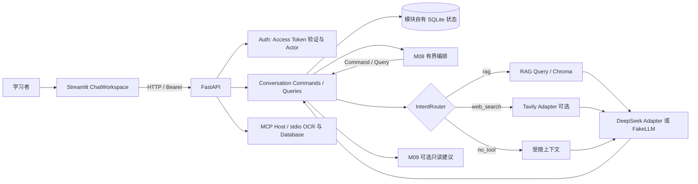

# Deutschpath Unified Agent

面向德语学习者的模块化对话 Agent。当前发布候选版本为 `0.1.1.dev0`；阶段四工程已实现 M07 会话历史、有限范围的 M08 编排、可选 M09 后续问题建议，并完成 M10 本地集成回归。它仍是本地/开发候选版本，尚未完成公网 OIDC、双用户生产隔离、容器部署与恢复验收，不应作为已验收的 v1.0 公网服务部署。

## 产品功能与技术栈

- FastAPI 提供 Chat、会话、附件、用户状态、身份验证及健康检查 API；默认开发端口为 `8765`。
- Streamlit 提供 ChatWorkspace、登录接线和版本中心；默认本机端口为 `8501`。真实 OIDC Provider 未配置。
- Python `>=3.14,<3.15`；FastAPI/Uvicorn；Streamlit；SQLite；ChromaDB；MCP Python SDK；RapidOCR/ONNX Runtime。依赖范围见 `pyproject.toml`；当前仓库没有完整 lockfile。
- LLM 可选接 DeepSeek；离线测试使用 FakeLLM。联网搜索可选接 Tavily；未进行实时连接测试时不能将答案描述为实时联网结果。
- TXT、MD、PDF、DOCX 文本解析和 Chroma RAG；扫描版 PDF 的通用 OCR 解析不在普通文件路径中。
- MCP Database/OCR 经本机 stdio Host 调用。写入需经过预览、用户确认和读回；目前不提供公网 MCP endpoint。

## 阶段四功能

### M07 — 对话历史与上下文

Conversation 通过 `ConversationCommands` / `ConversationQueries` 管理会话、消息、附件元数据、会话改名及只读上下文快照。历史持久化于 SQLite，可在服务重启后恢复；上下文最多携带最近 20 条消息和 12,000 字符。该字符上限不是精确 token 预算，也没有持久化对话摘要。资源归属由可信业务边界检查；当前本地开发 `X-User-ID` 不等于用户认证。

### M08 — 意图引导与有限编排

M08 复用现有 IntentRouter、Conversation Command/Query 与独立编排状态。已验证范围是 `rename_session → list_sessions` 的固定双步骤流程，含澄清、提案确认、重复确认保护及本机重启恢复。它**不是**通用任务规划器：不支持任意复杂任务分解、CRM 写入型任务或任意工具编排；公网环境写入路径关闭。

### M09 — 后续问题建议

只读确定性建议服务最多给出 3 个问题，默认关闭。开启后，用户点击建议只会把问题填入输入框，是否发送仍由用户决定；不自动触发写操作。

### M10 — 集成与验收

集成覆盖 Chat/API、Router、RAG、Conversation、M08、M09、MCP/OCR 与文件解析。发布副本回归结果及真实运行范围见 [阶段四提交与截图指南](docs/submission/stage4/README.md) 和 [M10 验收记录](docs/PHASE4_M10_ACCEPTANCE.md)。自动化测试不等于公网生产验收；真实 OIDC、双真实账号、Router 150 题人工冻结、DeepSeek/Tavily 真实连接、MCP Inspector GUI 与生产部署/恢复均未完成。

## 架构与公开接口

模块遵循“业务模块自身 + Command API + Query API”：业务模块拥有自己的规则、状态、Repository 与事务，消费者只依赖稳定服务契约/DTO；FastAPI 负责 HTTP 适配、可信 Actor 注入和组合装配，不直接跨模块访问 Repository/ORM。ChatWorkspace 通过 `Stage2ApiClient` 访问 FastAPI。



边界细节见 [模块边界](docs/architecture/MODULE_BOUNDARIES.md)、[公开契约](docs/architecture/PUBLIC_CONTRACTS.md)、[M08 编排](docs/architecture/M08_ORCHESTRATION.md)。

## Windows 本地安装与启动

要求 Windows PowerShell 和 Python 3.14。进入本仓库根目录：

```powershell
cd .\Deutschpath_agent_publish
py -3.14 -m venv .venv
.\.venv\Scripts\python.exe -m pip install --upgrade pip
.\.venv\Scripts\python.exe -m pip install -e ".[dev]"
Copy-Item .env.example .env
```

`.env.example` 默认没有真实密钥，空的 `DEEPSEEK_API_KEY` 使用离线 FakeLLM；`TAVILY_API_KEY` 为空时不应声称实时联网。启动两个本地服务并打开浏览器：

```powershell
.\scripts\start_app.ps1
```

API：`http://127.0.0.1:8765/health`；Streamlit：`http://127.0.0.1:8501`。默认只绑定 loopback。关闭时分别在 FastAPI 与 Streamlit 窗口按 `Ctrl+C`，先停 UI 再停 API。启动脚本检测端口服务身份，不会擅自复用或关闭其他程序。

M08 写入仅用于本地开发演示。启用前在本机 `.env` 明确设置 `APP_ENV=development`、`M08_LOCAL_ENABLED=true`，服务仍要求直接 loopback 请求；公网/production 不开放此实验写入。不要把个人 `.env`、`.streamlit/secrets.toml` 或密钥提交到 Git。

## 测试与验收命令

```powershell
.\scripts\run_tests.ps1
.\.venv\Scripts\python.exe -m pytest tests\integration\test_api_smoke.py -q
.\.venv\Scripts\python.exe scripts\m08_b_http_acceptance.py
.\.venv\Scripts\python.exe scripts\m08_c_http_acceptance.py
.\.venv\Scripts\python.exe scripts\m09_http_acceptance.py
.\.venv\Scripts\python.exe scripts\mcp_b6_http_acceptance.py
.\.venv\Scripts\python.exe -m compileall -q app ui scripts tests
git diff --check
```

Router 离线评估使用 Rules 开发集（不是 150 题人工独立验收）：

```powershell
.\.venv\Scripts\python.exe scripts\evaluate_intents_v2.py --router rules
```

`verify_tavily_live.py` 和 Hybrid Router 可能调用真实 Provider 并产生费用；仅在获得授权并配置凭据后运行。未完成人工标注和冻结前，不报告 Router 150 题独立准确率。

## 本次发布副本测试证据

2026-10-14 在 `Deutschpath_agent_publish` 独立 Git clone 中验证：

| 命令 / 操作 | 结果 | 限定 |
|---|---|---|
| `scripts/run_tests.ps1` | **269 passed, 1 skipped, 0 failed**；83.27 秒；2 条依赖弃用警告；exit 0 | 本地 `.venv` 是本次按 `--system-site-packages` 创建并对发布副本执行 `pip install -e ".[dev]"` 的验证环境；不是完全隔离的依赖镜像。唯一 skip 是当前 Windows 账户无法创建 OCR 测试 symlink |
| `python -m pytest tests\integration\test_api_smoke.py -q` | **1 passed**；2 条依赖弃用警告；exit 0 | 单独运行；没有计入上面的全量测试统计 |
| `scripts/m08_b_http_acceptance.py` | **PASS，exit 0**；loopback Uvicorn；普通 Chat、澄清、重启后确认、重复确认、跨用户拒绝、未支持写操作拒绝；目标标题 Query 读回正确 | 本机隔离数据库；不是公网 OIDC 认证 |
| `scripts/m08_c_http_acceptance.py` | **PASS，exit 0**；`rename_session` 与 `list_sessions` 均 SUCCEEDED；重复确认不重复执行；标题读回正确 | 固定两步骤，不是通用规划器 |
| `scripts/m09_http_acceptance.py` | **PASS，exit 0**；opt-in 返回 3 条 Ausbildung 建议、旧响应兼容、跨用户 404 | 使用本地服务/离线策略；建议只预填输入框 |
| `scripts/mcp_b6_http_acceptance.py` | **PASS，exit 0**；真实 loopback Uvicorn 与 stdio MCP；确认前 0 行、确认后插入并读回 3 行、跨用户 404、正常关闭 | 不代表 MCP Inspector GUI 或公网 MCP 验收 |
| `scripts/start_app.ps1 -CheckOnly` | **PASS，exit 0**；API/UI 依赖和版本可导入，端口可用 | 只执行启动前检查；本轮未打开 UI 浏览器窗口 |
| `python -m compileall -q app ui scripts tests`；`git diff --check`；`git diff --cached --check` | 均 **PASS，exit 0** | Git 对现有 CRLF 转换有提示；无 whitespace error |
| `scripts/evaluate_intents.py` | **18/18（100%）** | 18 条离线小样本，不是 300 开发集或 150 题人工独立验收 |

运行回归的解释器来自本次副本的 `.venv`；该环境为本次临时创建用于验证，`.venv` 被 `.gitignore` 排除且不会提交。完整 fresh isolated environment / Docker build 尚未验证。通过本机自动测试不表示真实 OIDC、公网服务或真实 DeepSeek/Tavily 验收通过。

## 课程第四阶段证据

`docs/submission/stage3/` 保留阶段三验收材料；`docs/submission/stage4/README.md` 提供阶段四演示顺序、截图文件命名、服务启动步骤和架构图。当前没有伪造或预制的运行截图。需要提交可视证据时，按指南实际启动应用和测试后截图；只截图不含密钥、私人附件或真实用户会话的临时演示数据。

## 已知限制与未完成事项

- 真实 OIDC Provider、面向 API 的 Access Token audience、双真实账号公网资源隔离、浏览器 Cookie/CSRF/登出策略尚未验收；`X-User-ID` 仅是开发分区标识。
- Docker Compose 与 Caddy 尚未完成真实 HTTPS、WebSocket、限流、上传限制、监控和恢复演练；不应向公网开放。
- DeepSeek/Tavily 实时请求需另行授权和留存脱敏证据；MCP Inspector GUI 尚未验收。
- Router 人工独立集仍未审阅/冻结。工具依赖空白工作表运行，但不得用开发集结果冒充人工真值。
- SQLite/Chroma 目前按单实例本机/单机方案设计；不承诺多 API 副本写一致性或跨模块 exactly-once。
- 依赖范围未锁定到完整 lockfile/镜像 digest；Windows symlink 环境仍有一个被跳过的测试。

公网范围、技术路线和 release blockers 见 [v1.0 范围冻结](docs/V1_RELEASE_SCOPE.md)、[发布清单](docs/RELEASE_CHECKLIST.md) 与 [发布阻塞项](docs/RELEASE_BLOCKERS.md)。应用版本仍为 `0.1.1.dev0`。
