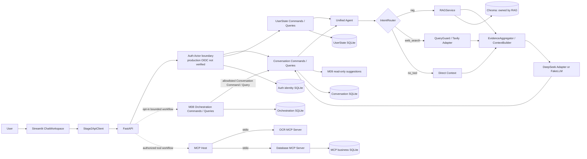

# Deutschpath Unified Agent

**v1.0 功能集成预览版 — 面向德语学习场景的模块化 AI Agent**
当前为 v1.0 功能集成预览版，生产发布验收仍在推进。软件版本为 `0.1.1.dev0`。

Deutschpath Unified Agent 面向德语学习和德国信息需求，将对话管理、学习者画像、文档检索、意图路由、联网搜索、MCP 工具、上下文记忆与受控多轮任务编排集成到一个应用中。模块通过明确的 Command / Query 和 Provider 接口协作，便于独立测试与替换。

项目从一个可测试的 Agent 核心逐步发展为本地聊天产品、文件知识系统、工具集成及有界任务工作流。它目前是本机功能集成预览，不能视为已完成公网生产验收的 v1.0 服务。

## Product Overview

- 与德语学习者对话，并在回答中使用 CEFR 学习档案、目标和偏好。
- 上传 TXT、Markdown、PDF、DOCX 学习资料，以会话隔离的 RAG 检索资料。
- Router 在 `rag`、`web_search`、`no_tool` 三类路径中选择；`mixed_sources` 是额外的证据选项。
- Tavily 和 DeepSeek 通过独立 Provider Adapter 接入；未配置或未实测时，应用不会将其描述为实时服务成功。
- OCR 与业务 SQLite 访问通过 MCP Host 及 stdio Server 隔离。数据库写入需用户检查和确认，并执行查询验证。
- SQLite Repository、Chroma 向量存储和稳定 API 契约将 UI、业务规则和数据访问分开。

## Demo

本发布副本当前没有可核验的真实产品截图，因此本页不嵌入占位图片。截图采集清单、每张图的准备步骤和验收条件见 [产品演示材料](docs/demo/README.md)。已记录的本机功能测试见 [工程质量](#engineering-quality)。

## Core Capabilities

| 能力 | 模块边界 | 当前状态 |
|---|---|---|
| 对话与会话 | Streamlit ChatWorkspace → API Client → FastAPI → Conversation Commands/Queries | 本机实现并测试；真实 OIDC 双用户公网验收未完成 |
| 学习者状态 | UserState Service / Repository / SQLite | CEFR 等级、目标、偏好及学习事件已实现 |
| 文件与 RAG | FileService → Parser → RAGService → Chroma | TXT/MD/PDF/DOCX、本地检索和会话 namespace 已实现 |
| 路由与 Web | Rule/LLM/Hybrid Router、QueryGuard、Tavily Adapter | 模块和离线测试已实现；独立 150 条 Router 指标未验证，当前 README 引用的发布副本报告未执行实时 Provider 测试 |
| MCP 工具 | Host → OCR / Database MCP stdio | 本机协议和确认写入闭环有验收记录；Inspector GUI 未验证 |
| 记忆与编排 | Conversation Queries、M08 Orchestration、M09 Suggestions | 会话历史恢复、受限双步骤流程、可选只读建议已实现并有本机验收记录 |
| 身份与部署 | Auth Actor Boundary、Streamlit OIDC 接线、Compose/Caddy 草案 | 离线/本地边界有测试；真实 IdP、公网双账号、容器部署与恢复演练未验证 |

状态依据和逐功能测试入口见 [发布范围与门槛](docs/V1_RELEASE_SCOPE.md)、[模块边界](docs/architecture/MODULE_BOUNDARIES.md) 和 [公开契约](docs/architecture/PUBLIC_CONTRACTS.md)。

## Architecture



**High Cohesion + Low Coupling + Stable Contracts + Testability**

The UI uses the API Client and does not query business databases. Each module owns its Repository and SQLite state; RAG alone owns Chroma. M08 currently executes only a bounded `rename_session → list_sessions` workflow after confirmation. MCP is a separate Host capability, not a fourth Router class. There is no global transaction across module databases. The diagram does not imply verified production authentication.

More detail: [Architecture overview](ARCHITECTURE.md), [Module boundaries](docs/architecture/MODULE_BOUNDARIES.md), [Public contracts](docs/architecture/PUBLIC_CONTRACTS.md), [M08 workflow](docs/architecture/M08_ORCHESTRATION.md).

## Evolution Roadmap

The ten milestones follow four engineering tracks. Each iteration builds on existing service boundaries and introduces only the interfaces needed by the next capability.

| Milestone | Product capability and problem solved | Reuse and interface evolution | Evidence / status |
|---|---|---|---|
| **Agent Foundation · M01–M02** ||||
| M01 | A single testable answer path instead of scattered model calls | `LLMClient`, `FakeLLM`, `DeepSeekLLM`; `UnifiedOrchestrator.answer` | Offline Agent/RAG integration tests; real provider is separately configured |
| M02 | Persistent learner context across requests | Reuses Agent context; adds `UserStateService` and Repository Commands/Queries for CEFR profile/events | Isolated SQLite unit and HTTP acceptance in `docs/iterations/M02_crm_state.md` |
| **Application & Knowledge · M03–M04** ||||
| M03 | A usable chat UI with durable sessions and one HTTP boundary | Adds Streamlit ChatWorkspace, `Stage2ApiClient`, FastAPI, `ChatService`, Conversation history | AppTest and loopback API acceptance; production identity is a separate gate |
| M04 | Searchable learning materials without coupling parsers to prompts | Adds `FileService` Parser Registry, `RAGService`, embedding Protocol and `ChromaVectorStore` namespaces | Parser, session isolation, RAG and lifecycle tests |
| **Routing & Tools · M05–M06** ||||
| M05 | Select local retrieval, public search, or direct response while keeping evidence distinct | Reuses Agent/LLM; adds three-class `IntentRouter`, separate `mixed_sources`, guarded `WebSearchProvider`, `EvidenceAggregator` | Offline routing/security suite; independent 150-label 98% result remains NOT VERIFIED |
| M06 | Add protocol-isolated OCR and database actions with reviewed writes | Adds MCP stdio Servers and `MCPHost` / Planner; writes require reviewed rows and confirmation | MCP protocol and isolated OCR→confirm→query HTTP evidence; Inspector GUI not verified |
| **Memory & Orchestration · M07–M10** ||||
| M07 | Give Conversation sole ownership of session commands, queries and bounded history | Reuses `ChatService`/SQLite; formalizes `ConversationCommands`, `ConversationQueries`, immutable DTOs and context snapshot | Compatibility, ownership, history and restart tests; 20-message / 12,000-character bounds |
| M08 | Safely handle one confirmed multi-step conversation task | Reuses Router and Conversation APIs; adds independent orchestration state and executor boundary for `rename_session → list_sessions` | Loopback HTTP, restart, duplicate-confirmation and result read-back evidence; not a general Planner |
| M09 | Offer optional next questions without writing state or sending automatically | Reuses Conversation snapshot and optional M08 Query; adds `FollowUpSuggestionService` read-only Query | HTTP/AppTest evidence; default off, up to 3 deterministic suggestions, click only prefills input |
| M10 | Consolidate integration evidence and establish a production release boundary | Reuses all modules; adds Auth token/Actor boundary and deployment drafts, without changing module ownership | Local regression/API evidence exists; real OIDC, two real accounts, independent Router, public deployment and recovery remain unverified |

Detailed per-milestone problem statements, contracts, implementations and limits: [M01–M10 iteration notes](docs/iterations/manifest.json). The manifest used by the local version panel lists M01–M10.

## Tech Stack

| Technology | Role |
|---|---|
| Python 3.14 | Application runtime (`pyproject.toml`: `>=3.14,<3.15`) |
| FastAPI / Uvicorn | HTTP contracts, validation, composition root, local API |
| Streamlit | ChatWorkspace and local system/version panels |
| SQLite | Module-owned persistence through Repository boundaries; no cross-module global transaction |
| ChromaDB | Vector storage owned and accessed by RAG |
| DeepSeek-compatible HTTP adapter / FakeLLM | Optional real LLM provider and deterministic offline tests |
| Tavily adapter | Optional public Web Search; key presence alone is not connectivity evidence |
| MCP Python SDK `1.30.0` | Standards-based stdio Database and OCR Servers |
| RapidOCR `3.10.0` / ONNX Runtime | CPU OCR engine and runtime |
| pytest / HTTPX | Unit, integration, API contract and local HTTP acceptance |
| Docker Compose / Caddy | Deployment drafts only; no verified public deployment |

Exact dependency ranges: [`pyproject.toml`](pyproject.toml). Current versions and lifecycle notes: [Technology stack](docs/TECH_STACK.md).

## Quick Start

Requirements: Windows PowerShell and Python 3.14. Run these commands from the repository root:

```powershell
py -3.14 -m venv .venv
.\.venv\Scripts\python.exe -m pip install --upgrade pip
.\.venv\Scripts\python.exe -m pip install -e ".[dev]"
Copy-Item .env.example .env
```

Add provider credentials locally to `.env` only if needed. Do not commit `.env`. Start the local backend and UI:

```powershell
.\scripts\start_app.ps1
```

The defaults are FastAPI `http://127.0.0.1:8765` and Streamlit `http://127.0.0.1:8501`. The app binds to loopback. `8000` is not used by this project. Stop each process with `Ctrl+C` in its own window.

## Engineering Quality

The following evidence was recorded in this local publish clone on 2026-10-14:

| Check | Result | Scope |
|---|---|---|
| `scripts/run_tests.ps1` | **269 passed, 1 skipped, 0 failed** | Isolated local pytest; one skip because the Windows account cannot create the OCR symlink fixture |
| API Smoke | **1 passed** | Separate local API smoke test, not included in the count above |
| M08-B / M08-C HTTP | **PASS** | Loopback Uvicorn; bounded confirmation, restart and Command/Query read-back |
| M09 HTTP | **PASS** | Loopback Uvicorn; optional suggestions and compatibility behavior |
| MCP B6 HTTP | **PASS** | Loopback Uvicorn + stdio MCP; confirmation-gated write and query verification |
| `compileall`, `git diff --check` | **PASS** | Local source and documentation checks |

These are local release-copy results, not public deployment results. They do not prove real OIDC, public two-account isolation, Router 98% independent accuracy, real DeepSeek/Tavily connectivity, MCP Inspector GUI, or production recovery.

The Router's 300-case engineering candidate score is not independent ground truth. The 150-case human worksheet remains unreviewed. See [M10 acceptance](docs/PHASE4_M10_ACCEPTANCE.md) and [release blockers](docs/RELEASE_BLOCKERS.md).

## Development Status & Roadmap

**Available in the local integration preview:** Chat, learner state, file parsing/RAG, three-class routing, guarded Web Search adapter, mixed evidence, MCP OCR/database confirmation workflow, Conversation history, bounded M08 demo, optional M09 suggestions.

**Work before a production release:** configure and test a real OIDC provider; verify two real accounts across all private resources; freeze and independently evaluate human Router labels; run real provider acceptance in the release environment; validate MCP Inspector; complete container/HTTPS, limits, monitoring, backup and recovery exercises. M08 remains a fixed example flow, not a general-purpose task planner.

The package version remains `0.1.1.dev0`; “v1.0 feature integration preview” describes the integrated feature scope, not a released `1.0.0` build. No `1.0.0` tag or release is implied.

## Documentation

- [Product demos and screenshot checklist](docs/demo/README.md)
- [Architecture](ARCHITECTURE.md) · [Module boundaries](docs/architecture/MODULE_BOUNDARIES.md) · [Public contracts](docs/architecture/PUBLIC_CONTRACTS.md)
- [M01–M10 iteration manifest](docs/iterations/manifest.json) · [M08 orchestration](docs/architecture/M08_ORCHESTRATION.md) · [M09 suggestions](docs/architecture/M09_SUGGESTIONS.md)
- [Release scope](docs/V1_RELEASE_SCOPE.md) · [Release checklist](docs/RELEASE_CHECKLIST.md) · [Release blockers](docs/RELEASE_BLOCKERS.md)
- [Stage 3 evidence](docs/submission/stage3/STAGE3_ACCEPTANCE.md) · [Stage 4 evidence](docs/submission/stage4/README.md)
- [Debugging guide](docs/DEBUGGING.md) · [Changelog](docs/CHANGELOG.md) · [Technology stack](docs/TECH_STACK.md)
