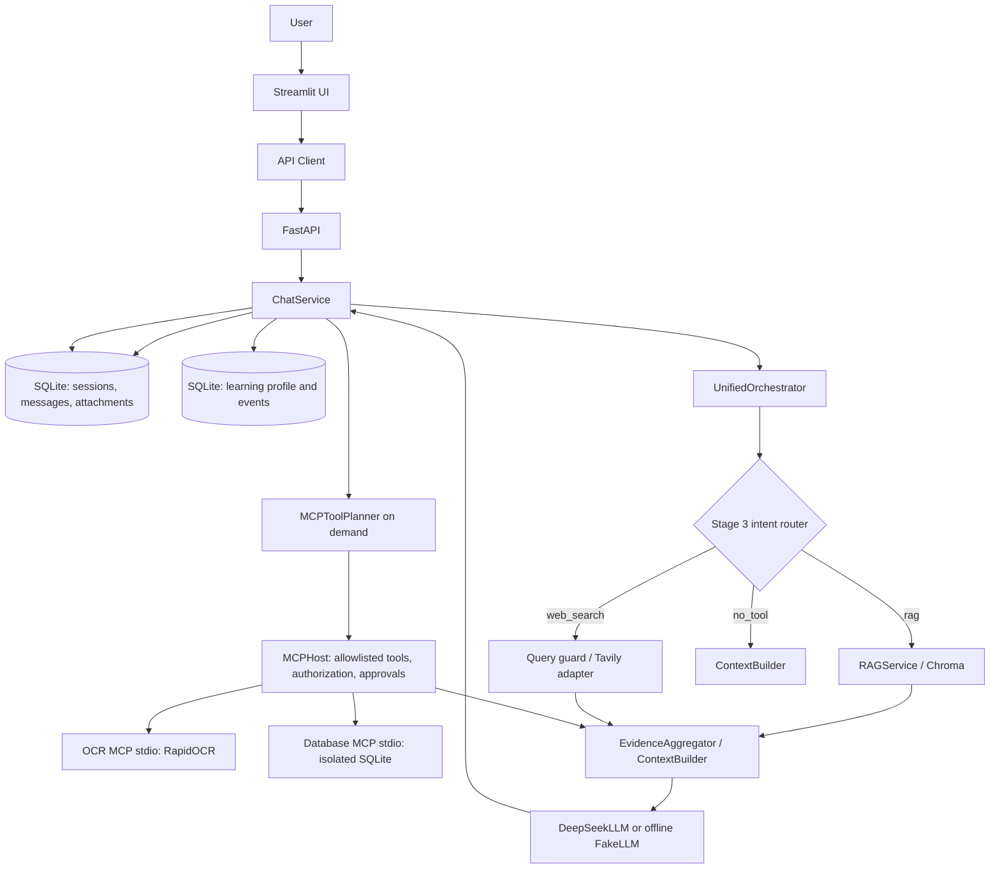

# Runtime architecture

This document describes the active root application. The controlled evolution
timeline is in [`iterations/manifest.json`](iterations/manifest.json), with
one evidence-oriented record for each milestone M01–M10. The Streamlit version
panel reads those repository-owned records and release documents; the JSON is
not an update feed and cannot load user-selected paths.

## Request flow

1. Streamlit ChatWorkspace calls FastAPI through `Stage2ApiClient`. The API
   converts the required caller-supplied local `X-User-ID` to an
   `ActorContext`. This selects a local data namespace but is not authentication.
2. Conversation Queries verify session ownership and return immutable Session,
   Message, or bounded ContextSnapshot DTOs. `ChatService` loads the latest
   attachment and owns Conversation writes; API routes do not access its
   Repository.
3. `UnifiedOrchestrator` asks the three-class Router for `rag`, `web_search`,
   or `no_tool`. `mixed_sources` is an additional evidence choice; it is not a
   fourth intent.
4. The selected path may retrieve session/knowledge RAG, call the guarded
   Tavily provider, or build direct prompt context. Mixed requests aggregate
   local and public evidence separately and preserve citations.
5. For OCR/database tasks, the separate MCP planner selects a bounded Host
   operation. The trusted Host performs real MCP stdio calls. Database writes
   require review and explicit confirmation before read-only verification.
6. DeepSeek or FakeLLM produces the answer. `ChatService` persists the assistant
   response; UI refreshes from the selected Session history.

## State and storage boundaries

- Chat Sessions/messages/attachment metadata and CRM learning state currently
  use distinct tables in `STAGE2_DATA_PATH/stage2.db`, with separate owner
  services and repositories. MCP Host workflow state uses its own SQLite file.
- Chroma data uses the same root but separate knowledge/session namespaces.
- OCR staging and MCP workflow metadata are Host-owned. MCP business records use
  a separate SQLite database and never reuse the chat/CRM database.
- `data/`, `.env`, and `.venv/` are local state/configuration/runtime and remain
  outside version control.

`X-User-ID` is a local beta identifier, not production authentication. Bind API
and UI to loopback. The system is a local engineering beta, not a production
deployment.

## Module boundaries

- **State:** Conversation Commands/Queries mediate ChatService operations;
  ChatRepository owns sessions/messages/attachment metadata internally.
  UserStateRepository owns learner profiles/events. Both currently use the
  `stage2.db` file but remain separate business modules.
- **Reasoning:** UnifiedOrchestrator asks the Stage 3 Router for one of three
  intents (`rag`, `web_search`, `no_tool`). `mixed_sources` is evidence metadata,
  not an additional intent.
- **Action:** RAGService, the guarded WebSearchProvider, or the separate MCP
  planner/Host are selected on demand. MCP database writes require explicit
  review/confirmation; the Router does not dispatch MCP operations.
- **Evidence:** ContextBuilder and EvidenceAggregator package bounded local,
  web, or verified tool results as data for the model.
- **Response and persistence:** LLMClient generates the answer; ChatService
  persists the assistant message and the UI reloads the selected session.
