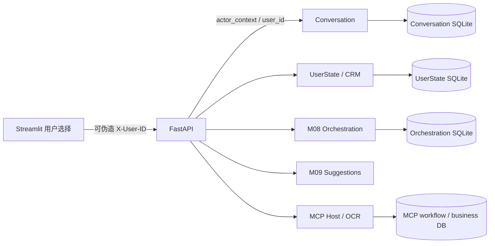

# M10-P0 阻塞项清除准备报告

日期：2026-10-13。版本：`0.1.1.dev0`。本报告是 Auth-C 开发前的历史快照：当时完成仓库审计、身份架构设计和 Router 人工评估准备工具，尚未完成认证实现。其后的 UI/Bearer 实现和当前范围见 [`PHASE4_M10_AUTH_UI_ACCEPTANCE.md`](PHASE4_M10_AUTH_UI_ACCEPTANCE.md) 与唯一范围规范 [`V1_RELEASE_SCOPE.md`](V1_RELEASE_SCOPE.md)。Router 人工独立验收仍未完成，v1.0 仍 NOT READY。

## 1. Git 仓库安全

- 根目录：`D:/CloudForge/AI_private/AI_Workbench/07project/Deutschpath_agent`；分支 `main`；HEAD 与 `origin/main` 均为 `916e3dc`。
- Fetch/Push remote 是 `https://github.com/JXcloudforge/CRM-agent.git`。HEAD 提交 `feat(crm): finalize P8 teacher feedback improvements`，父提交 `feat:CRM agents`，说明当前 Git 历史是 CRM 工程历史。无法仅凭本地状态确认此远端是否有意变成统一 Agent 的正式仓库。
- 最终快照：281 条路径；33 `AM`、90 staged `A`、98 unstaged `D`、60 untracked；staged 涉及 123 路径、unstaged 涉及 131 路径、untracked 60 路径。unstaged diff 为 131 files changed、1462 insertions、10378 deletions；staged diff 为 123 files changed、8168 insertions。98 条删除位于旧 `02_crm_agent`，目前未 staged。是否用户有意尚不能判断，必须由仓库所有者明确。
- 未发现跟踪的 `.env`、数据库/向量库、私钥文件或按路径可识别的个人资料；`.env` 和运行目录忽略规则有效。忽略列表无已跟踪文件。Router 题库是待授权审查的工程验收材料。
- 没有更改 remote、暂存、提交、删除或推送。详细建议见 `docs/GIT_SAFETY_REPORT.md`。

## 2. 身份入口审计及依赖图

Streamlit 的 API Client 将当前可编辑/可选 user ID 放入 `X-User-ID`。FastAPI `user_id()` 和 `actor_context()` 不验证凭据；Chat `ActorContext.from_local_header` 明确注明身份不可信。Conversation、CRM、M08、M09、MCP Host 使用 user_id 做 owner filter，但攻击者可伪造目标用户的 header。`GET /users/me/*`、会话/消息查询等读取因此也有越权风险；production mutation fail-closed 不能保护读取。OCR Host 的 image/session ownership 和操作确认保护工作流一致性，不能认证请求人。隔离临时数据库实测：以未认证调用方伪造 `X-User-ID=owner-123` 请求消息查询，HTTP 200 且读回受保护测试标记。

具体传播、授权边界和迁移策略见 `docs/architecture/AUTHENTICATION_BOUNDARY.md`；方案比较和决策项见 `docs/SECURITY_AUTH_PLAN.md`。本轮没有建立新的 Actor 代码契约或切换 HTTP 身份，避免在账户/部署目标未知时造成兼容和数据迁移风险。

### 可行方案与推荐

- **本地正式版 A：** 明确为单一受控 Windows OS 登录用户；服务仅 loopback，数据目录按 OS ACL 保护，不宣称同机恶意进程或多账户隔离。服务端固定本地 principal，不接受客户端 `X-User-ID` 作为身份；同源 session 与 CSRF/Origin 控制按具体 UI 方案实现。
- **公网多用户版 B：** 使用标准 OIDC IdP；Authorization Code + PKCE，服务端验证身份 token/session 后将 issuer+subject 映射本地稳定 user ID；优先服务器会话与 Secure/HttpOnly/SameSite Cookie、CSRF、严格 CORS/Origin、过期撤销、TLS、secret manager 和 role/scope capability。绝不自制密码学。
- 若目标是当前个人本机项目，建议 A；若有远程/多用户要求，必须选择 B 和实际 IdP。需要用户决定 v1.0 部署类型、账户/恢复责任人、角色/租户、域名/可信代理、session 存储和账户映射迁移后，才实施认证。

## 3. Router 人工验收准备

经 UTF-8 BOM CSV 解析：14 列与顺序正确；150 行、150 个唯一 case_id；状态 `unreviewed` 150；所有 annotator 1/2、adjudicated intent/mixed 字段为空；freeze_batch 全空。未填写任何标签。

新增 `scripts/router_human_eval.py`，复用现有 `app.routing.evaluation.evaluate`。工具提供结构审计、隔离标注副本、逐题人工标注（只显示题面和附件标识，不显示预测）、独立双份合并、分歧手工裁决、缺项/非法标签拦截、SHA-256 冻结 manifest、冻结后 hash 校验，以及 Rules/Hybrid 指标报告。原 CSV 题目不会由工具修改；冻结和评估输出拒绝覆盖已有文件。Hybrid 模式明确要求真实 DeepSeek，FakeLLM 被拒绝。

已有 `evals/v011_hybrid_300_final.json` 存档显示开发集 300/300，Accuracy、Macro F1、mixed_sources Accuracy 均为 1.0；这只是历史开发证据。本轮不重跑会覆写用户结果的脚本，不把它作为人工真值。独立表 0/150 已标注，因此正式 Accuracy、Macro F1、分类指标和混淆矩阵 **NOT VERIFIED**。8 条 token overlap 候选须由验收负责人人工检查。

具体操作、命令及标签解释见 `docs/ROUTER_HUMAN_ANNOTATION_GUIDE.md`；冻结门槛与状态见 `docs/ROUTER_INDEPENDENT_ACCEPTANCE.md`。

## 4. 本轮文件清单

- 新增：`scripts/router_human_eval.py`；`tests/unit/test_router_human_eval.py`。
- 新增：`docs/GIT_SAFETY_REPORT.md`、`docs/architecture/AUTHENTICATION_BOUNDARY.md`、`docs/SECURITY_AUTH_PLAN.md`、`docs/adr/ADR-authenticated-actor-boundary.md`。
- 新增：`docs/ROUTER_HUMAN_ANNOTATION_GUIDE.md`、`docs/ROUTER_INDEPENDENT_ACCEPTANCE.md`、本报告。
- 更新：`docs/RELEASE_BLOCKERS.md`、`docs/RELEASE_CHECKLIST.md`。保持原有预发布版本和现存 CSV/数据库内容。

## 5. 测试与检查

| 命令 | 结果 |
|---|---|
| `.\scripts\run_tests.ps1` | exit 0；254 passed、1 skipped、0 failed；2 依赖弃用警告。唯一 skip：Windows symlink 权限。 |
| `.\.venv\Scripts\python.exe -m pytest tests\unit\test_router_human_eval.py -q` | exit 0；9 passed。覆盖结构、非法/缺失标签、双盲副本、人工录入、共识/分歧、裁决、冻结哈希和 Rules 指标结构。 |
| `.\.venv\Scripts\python.exe scripts\router_human_eval.py audit` | exit 0；14 列、150 行、150 唯一 ID、全未审阅，结构有效。 |
| `.\.venv\Scripts\python.exe -m pytest tests\integration\test_api_smoke.py -q` | exit 0；1 passed。 |
| M08-B、M08-C、M09、MCP B6 loopback 脚本 | 四项均 exit 0；详见对应既有验收报告；其中 M08 生产写入限制用例另见下一项。 |
| `.\.venv\Scripts\python.exe -m pytest tests\integration\test_m08_chat_integration.py::test_production_mutating_http_routes_fail_closed -q` | exit 0；1 passed，生产 mutation fail-closed。它不保护 GET。隔离负向探针伪造 X-User-ID 读取临时受保护 marker，实测 HTTP 200，故认证安全 FAIL。 |
| `.\.venv\Scripts\python.exe -m compileall -q app ui scripts tests` | exit 0。 |
| `git diff --check`、`git diff --cached --check` | 均 exit 0；仅 LF/CRLF 提示，无 whitespace error。 |

本轮环境为 Windows PowerShell、Python 3.14.6。DeepSeek/Tavily 没有外呼；真实用户数据库未修改；没有 Git 写操作。

## 6. 状态和下一步

| 项目 | 状态 |
|---|---|
| Git 安全审计 | PASS（只读审计）；仓库归属和删除意图 NOT VERIFIED |
| 可信身份 | FAIL；伪造 header 成功读回临时保护标记；认证设计完成但未实现 |
| Router 150 题数据结构 | PASS |
| Router 两人标注、裁决、冻结、独立成绩 | NOT VERIFIED（0/150） |
| 外部 DeepSeek/Tavily | NOT VERIFIED，本轮未调用 |
| v1.0 正式发布 | BLOCKED |

下一轮行动：仓库所有者确认正式仓库和旧 CRM 删除意图；产品所有者选择本地单用户或公网多用户认证方案及账户负责人；按指南人工完成两份独立标注并裁决；审阅题目重叠后冻结；经批准再运行可能计费的 Hybrid 独立评估；完成选定认证方案、全端点隔离测试及部署恢复演练。版本继续 `0.1.1.dev0`。
