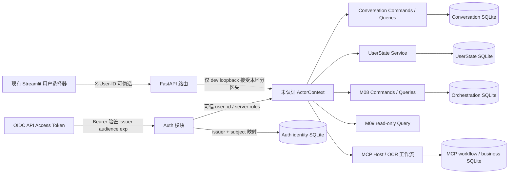

# 身份认证与授权边界

日期：2026-10-13。v1.0 目标已确定为公网多用户 OIDC。本文件记录当前本地实现；真实 OIDC 登录和公网部署仍未验收。

## 当前边界（不可信）

现有 Streamlit 的 `Stage2ApiClient._headers(user_id)` 仍将 UI 用户选择写入 `X-User-ID`，因此该 UI 不能用于公网多用户部署。FastAPI 当前在生产模式拒绝仅有该 header 的请求；未配置 OIDC 时不认证访问。development 下仅直连 loopback 且无 forwarded headers 可用于本地测试。Conversation、M08、M09、MCP Host 的 owner 查询保护已认证 Actor 所代表的分区，但 owner 检查本身不证明调用者身份。

Auth-C 将生产 Streamlit 入口改为 fail-closed OIDC：用户完成 `st.login(provider)` 后，服务端只从 `st.user.tokens.access` 取 Access Token，并以 Bearer 交给 `Stage2ApiClient`；该模式不发送 `X-User-ID`。FastAPI 对每次私有请求重新验证 issuer、audience、签名与过期并映射内部用户。OIDC `iss+sub` 的哈希只用于隔离 Streamlit session state，绝不授权或发往 API。development 保留 loopback 的本地 User ID 测试路径。

生产 UI 要求 `[auth] expose_tokens="access"` 和 provider `client_kwargs.audience`（或 `resource`），且 API 独立校验 audience。API 返回 401 后当前 Client 立即失效，不重试；UI 标记需重新认证并停止后续私有请求。`st.logout()` 清理 Streamlit 登录 cookie/本地会话；它不保证撤销 IdP 会话或已签发 Access Token。真实 provider 未配置，真实登录仍 NOT VERIFIED。

私人资源包括 profile/events、会话列表/消息、附件关联内容、M08 状态、M09 上下文与 MCP OCR workflow。HTTP 私有路由现统一依赖 `get_actor_context`。生产中 OIDC Bearer 经签名、issuer、audience、expiry 和 Access Token 标记验证，再映射到稳定用户；无效/缺配拒绝。OCR staging/confirm 仍需先经过可信 API Actor 与 session owner 校验。MCP 仅由 FastAPI 内部调用 stdio Host，不存在公网 MCP HTTP endpoint；部署必须保持 Host/业务库不暴露。

## 目标可信 Actor 契约

认证适配器验证请求后产生不可变的 `VerifiedPrincipal`；API dependency 将它映射为模块调用的可信 `ActorContext`。客户端不能构造或覆盖这个上下文。

当前公共字段：

- `user_id`：身份提供方 `issuer + subject` 到本地稳定账户 ID 的服务端映射结果；不可取自请求 body/header 中任意的用户 ID。
- `identity_source`：已验证 issuer / 本地受信认证方式的标识，不包含密钥。
- `authenticated`：只由服务端验证器生成的状态，调用者不可传入。
- `roles`：Auth-owned SQLite 中的服务端角色；未提供令牌内角色授权。
- `issuer` / `subject`：已验证主体键；不含 Token 本身。

VerifiedPrincipal 另外包含有效期和 scope，处于 Auth 适配边界，不向业务模块暴露原始 Token。当前验证算法白名单为 RS256/ES256，JWKS URL 要求 HTTPS。生产需配置 OIDC_ISSUER、OIDC_AUDIENCE、OIDC_JWKS_URL。

授权仍由资源所属模块执行：Conversation 用可信 `user_id` 校验会话 owner；UserState 用可信 subject 映射后的账户 ID；M08 绑定 orchestration owner 和 Conversation Command；M09 Query 复用 Conversation/M08 Query 的访问控制；MCP Host 以可信 Actor 与 session 对 workflow/image 作 owner 检查，Database MCP 的写批准继续绑定精确操作。API dependency 只验证身份并提供 Actor，不绕过业务 Command/Query。

未经认证的私有 API 返回 401；已认证但无 capability 返回 403；资源不存在和非 owner 同样返回 404。健康检查可以作为明确公开例外。生产模式无任何 Header fallback；开发模式也必须由配置明确启用并限 loopback，测试身份不得混入生产依赖。

## 迁移兼容原则

现有 `ActorContext` 位于 `app.chat` 且标注 `caller_supplied_x_user_id`，不应继续承载“可信 Actor”语义。选择方案后新增共享 identity contract/认证 adapter，由 FastAPI 做依赖注入；Conversation 等模块只消费 Actor DTO/Protocol，不 import FastAPI、Cookie、OIDC SDK 或 Repository。随后一次迁移所有 GET/POST/PATCH 与 MCP/OCR HTTP 入口。UI 取消用户 ID 选择后随请求发送的身份语义，改用同源登录会话；`X-User-ID` 只能被忽略或在迁移期拒绝，绝不作为 fallback。

目前各业务库用 `user_id` 文本分区，无身份外键。Auth 新身份生成独立 UUID，不自动认领既有本地 ID 或数据。旧本地数据的迁移需要明确人工账户关联策略、离线映射、每库备份、冲突预检、临时副本迁移和反向映射演练；本轮未修改业务数据库。

## 状态

- 当前旧 Streamlit UI 到 API 的可信身份链：**FAIL（不得公网发布）**。
- Auth 公共 DTO、OIDC Access Token 验证和身份映射：**离线实现 PASS；外部 IdP 未配置**。
- 本机隔离数据库完整性：与认证不同，详见 M10 报告。
- 私有 FastAPI 路由 actor 依赖及伪造 header 拒绝：**本地 HTTP 测试 PASS**。
- 真实 OIDC 登录、Streamlit token relay、Cookie/CSRF 会话、VPS TLS 和恢复：**NOT VERIFIED**。
