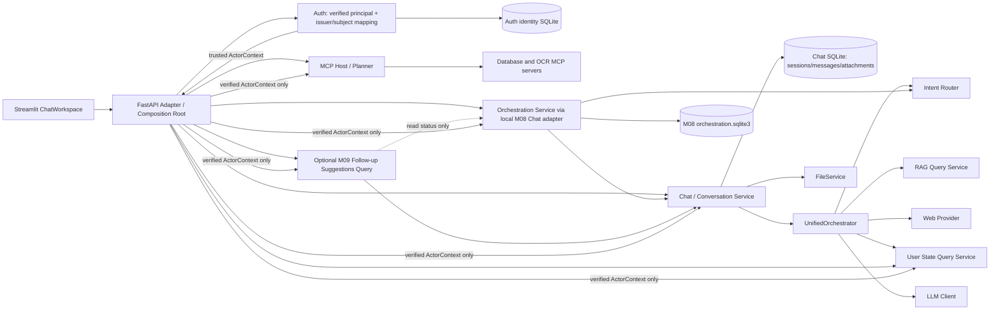

# 模块边界与依赖清单

更新日期：2026-10-13。本文描述当前统一工程源码。`app/api/main.py` 是组合根和 HTTP 适配器；面向其他业务模块的依赖应使用目标模块的服务契约。`app/*/repository.py` 内的 SQLite、向量存储细节属于数据所有模块。

## 依赖方向

ChatWorkspace 是 `ui/streamlit_app.py` 的 Streamlit 聊天界面，通过 `Stage2ApiClient` 消费稳定的 HTTP JSON 契约，不连接数据库。审计发现真正越界发生在 API 适配器：它曾通过 `chat.repository` 执行会话列表、改名、历史读取、OCR 会话归属检查和确认后的助手消息写入。M07 将这些调用迁移到 Conversation Queries/Commands；HTTP 路由、字段和身份行为保持兼容。

## 业务模块清单

| 模块 | 唯一职责和数据所有权 | 公开接口 / 依赖 | 审计状态与处置 |
| --- | --- | --- | --- |
| ChatWorkspace (`ui/`) | UI 状态、渲染和 HTTP 请求；不拥有会话持久化 | `Stage2ApiClient`；依赖 FastAPI JSON 契约 | 已使用 API Client；保留。不直接查库 |
| API (`app/api`) | HTTP 校验、错误映射和应用组合 | 路由、Pydantic 请求体；依赖业务服务 | UserState 通过模块工厂 `UserStateService.from_path` 组合；Conversation 数据经公开 Commands/Queries；上传入口在写文件前校验 owner、扩展名和 20 MiB 上限 |
| Auth (`app/auth`) | OIDC API Access Token 验证及 provider subject 到稳定内部用户 ID 的映射 | `AuthService.authenticate`、`IdentityMappingService` Commands/Queries、`ActorContext` / `VerifiedPrincipal` DTO | Auth 独占 identity SQLite；生产私有 HTTP 路由经 `get_actor_context` 依赖。只接受配置 issuer/audience/JWKS 的 Bearer；本地 X-User-ID 仅 development loopback；Streamlit OIDC 尚未接通 |
| Conversation / Chat (`app/chat`) | 会话、消息、附件元数据、顺序和上下文快照 | M07 `ConversationCommands`、`ConversationQueries`、不可变 DTO；内部 `ChatRepository` | 会话数据唯一所有者。M07 隐藏 Repository，并由模块服务管理上下文读取/裁剪 |
| Orchestration (app/orchestration) | 有界计划、依赖步骤、澄清/确认、步骤尝试和结果引用 | OrchestrationService Commands / Queries、OrchestrationStep DTO；内部 SQLite/Repository；API 组合根以关闭默认的本地 Chat adapter 接入 | M08 拥有计划和步骤状态，不拥有 Chat/CRM 业务数据；只注册 Conversation rename_session Command 与 list_sessions Query |
| Suggestions (`app/suggestions`) | 根据当前问题、回答和有界上下文提供可选后续问题 | `SuggestionQueries.get_follow_up_suggestions(actor, session_id, maximum=3)`；不可变 DTO；Conversation Context Query、可选 M08 Status Query | 无持久化与 Command；离线规则策略，返回 0–3 条；API 默认不调用；UI 点击只填入输入框 |
| User State / CRM (`app/users`) | 学习档案和事件 | `UserStateService` 的读写方法及模型 | Agent/API 消费服务；API 不再 import/构造 Repository；Repository 属性仍为历史兼容细节，后续可在单独兼容评审中封装 |
| Agent (`app/agent`) | 组装提示上下文、调用路由/证据源、生成回答 | `UnifiedOrchestrator.answer`、`answer_from_tool_result` | 依赖 Router/RAG/Web/UserState/LLM 服务边界；无持久化所有权 |
| Routing (`app/routing`) | 三类意图判定及决策元数据 | `IntentRouter.route`、`RouteDecision` | 模块边界清楚；`mixed_sources` 是证据选项，不另建路由器 |
| RAG (`app/rag`) | 文本向量化、namespace 检索及检索上下文 | `RAGService`、Embedding Protocol、`ChromaVectorStore` | Orchestrator 通过服务访问；Store 由 RAG 模块拥有。session namespace 使用 Conversation 的 ID，不写 Chat SQLite |
| Files (`app/files`) | 文件格式校验、解析和 `ParsedDocument` 产生 | `FileService.parse`、Parser Registry | Conversation 使用解析结果。API 当前负责写入上传临时文件，属于待迁移的文件存储边界问题 |
| Web (`app/web`) | 搜索查询防护和 Web Provider 适配 | `SearchQueryBuilder`、`WebSearchProvider.search` | Orchestrator 依赖 Provider；密钥配置不等于实时联通 |
| MCP Host / Planner (`app/mcp`) | 受限 MCP 调用、授权、确认和工作流状态 | `MCPHost`、`MCPToolPlanner` | 独立于三类 Router；Host 内部管理其状态与业务库调用，不由 Chat 直接访问 MCP Repository |
| Database MCP | MCP 业务 SQLite 的 schema、受控读写与一次性批准 | MCP tools/resources/prompt | 该数据库由 Database MCP 服务拥有，与 Chat/CRM SQLite 分离 |
| OCR MCP | 授权图片 OCR 和候选文本 | MCP `ocr_extract` | OCR 输出是不可信候选；图片由 Host 管理授权/暂存 |
| LLM (`app/llm`) | 模型 Provider 适配 | `LLMClient` Protocol、Fake/DeepSeek 实现 | Agent 注入接口；Fake 测试不证明外网调用 |
| Version/UI metadata | 版本展示 | `app.version`、受控文档 | `pyproject.toml` 是唯一应用版本源；不拥有业务状态 |

## 数据所有权与待办

- Chat Service 独占 `chat_sessions`、`chat_messages`、`attachments` 的命令与查询。FastAPI 只能传 DTO、错误和授权上下文。
- User State Repository 由 User State Service 管理；API 组合根使用 `UserStateService.from_path`，不依赖 Repository 类型。
- MCP Host 状态、OCR staging 和 MCP Business SQLite 分属 Host/Server；跨模块协调由 MCP Host 对外方法负责。
- RAG 向量索引属于 RAG。Conversation 上传调用 `FileService` 和 `RAGService`，不得由 UI/API 直接写 Chroma。
- FastAPI 上传 Handler 在本机数据根目录暂存文件；先经 Conversation Query 验证会话归属，只接受 TXT/MD/PDF/DOCX，读取上限为 20 MiB，再交给 Conversation Command 解析、保存元数据并请求 RAG 索引。文件字节的长期所有权与解析失败后的清理策略仍需单独设计。
- OIDC Actor 的稳定 user_id 来源为 Auth 的 issuer+subject 映射，不读取 token 内 user_id/email。生产无 X-User-ID fallback。development loopback 的 header 只用于本机测试；当前 Streamlit 仍发送该 header，因此公网 UI 链路未通过。
- M08 的状态库独立于用户 Chat DB，忽略规则已覆盖 *.sqlite3。API 组合根只在显式本地开关和 development 环境注册 adapter；执行器通过 Conversation Commands/Queries 做真实改名与列表读取。M08-C 在自有 SQLite 新增步骤表，不改用户 schema。没有正式 CRM task Command 时，其他写操作拒绝执行。生产若配置真实 OIDC 可执行各自已有业务 Command；M08 adapter 当前仍关闭。

## 兼容和验收

M07 保留既有 HTTP method/path、成功 JSON 字段和错误码，只改变 API 内部依赖方向。Conversation DTO 是模块内公共契约；Repository 不在 `app.chat` package export 中。依赖检查确保 `app/api`、`ui`、`app/agent` 不引用 `ChatRepository` 或访问 `.repository`。SQLite schema 不变，查询不提交业务写入。

