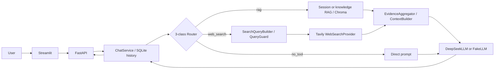

# Stage 3 验收架构

## Request boundaries

1. Streamlit sends requests to FastAPI with the local `X-User-ID` and session ID. FastAPI persists messages through `ChatService`/`ChatRepository`.
2. `ChatService` loads bounded conversation history and the selected session attachment. The router returns only `rag`, `web_search`, or `no_tool`; `mixed_sources` remains a separate boolean on the route decision.
3. For mixed requests, `SearchQueryBuilder` removes local-file framing and validates the public query. The local attachment is passed only to local evidence construction. Tavily receives only the guarded public query.
4. `EvidenceAggregator` retains local and web evidence separately, and `ContextBuilder` packages both for DeepSeek. The answer returns through the chat service and is persisted with source citations.
5. MCP is a separate on-demand host/planner capability. It is not a fourth router intent and was not part of this course Web/Mixed live request.

## Isolation and verification

The live acceptance server used an ephemeral loopback port and a unique system-temp `STAGE2_DATA_PATH`, deterministic embeddings, the real Rules Router, real Tavily HTTP, and real DeepSeek HTTP. An instrumented wrapper captured the route decision and public query without recording credentials or attachment contents. The server shut down after the request. The separate automated suite covered CRM, Session, RAG, MCP, routing and security paths.

The health endpoint's provider/Router type fields were not used as evidence in this instrumented run because the test wrapper intentionally replaced those objects for telemetry. Connectivity is evidenced by actual 200 message responses, real provider results, orchestrator diagnostics, and citations.
