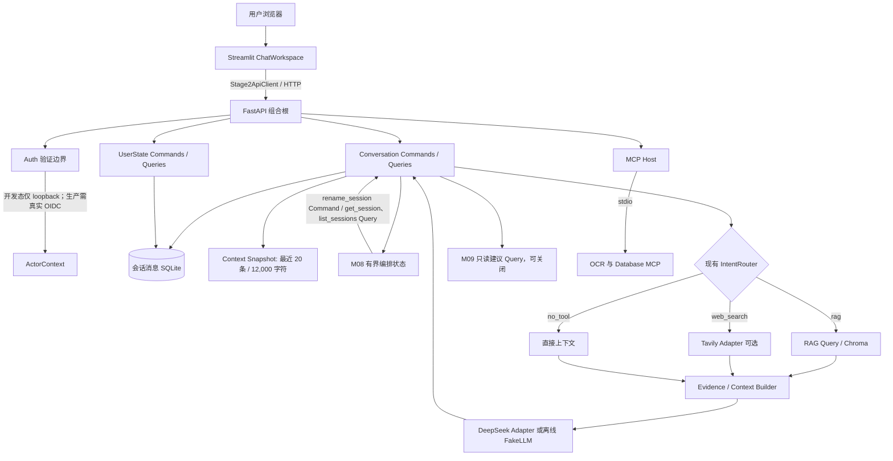

# 阶段四课程提交与真实截图指南

本文说明在 Windows 本机用隔离演示数据复现阶段四功能、采集课程证据并核对运行结果。当前仓库没有提交实际运行截图；请按步骤自行从真实 UI/终端截图，不得使用合成截图、报告图片或 Fake 输出冒充真实 Provider。

## 本地演示环境

从发布仓库根目录打开 PowerShell。演示数据放在系统临时目录，避免使用开发工程中的会话、附件和用户资料：

```powershell
$env:STAGE2_DATA_PATH = Join-Path $env:TEMP 'Deutschpath-stage4-demo'
$env:APP_ENV = 'development'
$env:M08_LOCAL_ENABLED = 'true'
Copy-Item .env.example .env -ErrorAction SilentlyContinue
```

确保 `.env` 中的 `DEEPSEEK_API_KEY`、`TAVILY_API_KEY` 为空，使用离线 FakeLLM；不要截图或分享设置面板中任何密钥。已按 README 安装 `.venv` 后，在同一个 PowerShell 窗口运行：

```powershell
.\scripts\start_app.ps1
```

启动器会打开 FastAPI 和 Streamlit 窗口并打开 `http://127.0.0.1:8501`。本地 UI 的测试用户标识不是生产认证。所有截图使用新建的演示账号/会话和临时目录，不上传真实附件。

结束服务时分别在 UI 与 API 窗口按 `Ctrl+C`，先停止 Streamlit，再停止 FastAPI。若要测试 API 单独重启恢复，保留 `$env:STAGE2_DATA_PATH` 的值并在同一 PowerShell 会话重新运行 `scripts/start_backend.ps1`，然后刷新仍打开的浏览器。

## 阶段四架构图

下面是基于实际模块和调用边界的课程架构图，不是生产部署图：



每个业务模块拥有自己的规则、持久化和事务；调用方只使用 Commands/Queries 及 DTO。该图不表示跨 SQLite 的分布式事务，也不表示 M08 有通用工具规划能力。

## 演示与截图清单

请使用 Windows 截图工具（`Win+Shift+S`），截图中保留应用标题、操作结果或测试摘要；隐藏桌面通知、用户资料、环境变量、Token、密钥输入框和私人附件正文。使用以下文件名保存到课程系统或个人受控目录；仓库不要求提交运行数据或带用户资料的图像。

| 文件名 | 实际操作 | 截图必须展示 |
|---|---|---|
| `stage4-01-chat-history.png` | 创建演示会话并发送一条普通德语学习问题；选中历史会话 | 会话列表、真实本地回答、会话消息历史 |
| `stage4-02-restart-recovery.png` | 记录当前会话后，在 API 窗口按 `Ctrl+C`；保持 UI 运行；在同一 PowerShell 环境重启 `scripts/start_backend.ps1`；刷新会话 | `/health` 正常与重启后原会话/消息仍可读取。终端不得展示环境变量或密钥 |
| `stage4-03-clarification.png` | 新建演示会话，输入“把当前会话改名”，观察系统要求提供名称；下一轮只发送标题，例如“德语考试复习” | 澄清问题与补充轮次关联原提案；此时尚未确认、标题未被提前改写 |
| `stage4-04-confirmed-command-query.png` | 在该会话确认改名；另开新会话可尝试“先把当前会话改名为阶段四演示，然后列出会话”，按 UI 明确请求确认后再确认 | 原会话标题已更新；M08 返回 Command/Query 步骤结果或消息；不要仅以状态文字代替真实标题读回 |
| `stage4-05-m09-suggestion-prefill.png` | 勾选“推荐后续问题（可随时关闭）”，提问一个 Ausbildung 或德语学习问题；点击建议按钮但不要提交 | 回答后出现相关建议；点击后输入框被填入且尚未发送；也可附关闭开关状态 |
| `stage4-06-full-tests.png` | 运行 `.\scripts\run_tests.ps1`；等待退出并单独运行 API Smoke | PowerShell 显示最终 pytest 统计、退出码；无测试密钥或私人目录输出 |
| `stage4-07-system-architecture.png` | 在 GitHub Markdown 预览中打开本文架构图或 README 架构图 | Mermaid 渲染清晰、模块边界及调用方向可读 |

第五张图的建议按钮点击只预填输入框，不会自动执行命令。第四张图的可见结果必须与真实会话标题读回一致。不要在生产身份门槛未通过时截图宣称公网双用户隔离。

## 测试及作业记录

全量自动测试命令：

```powershell
.\scripts\run_tests.ps1
```

该脚本排除 API Smoke，须独立执行：

```powershell
.\.venv\Scripts\python.exe -m pytest tests\integration\test_api_smoke.py -q
```

本次独立发布副本回归为 **269 passed、1 skipped、0 failed**；唯一跳过是 Windows 当前账户不能创建 symlink 的 OCR 测试。另有 2 条依赖弃用警告。此回归由开发工程现有依赖环境运行发布副本源码，不是干净虚拟环境安装验证。其它 M08-B/C、M09、MCP B6 HTTP 结果以报告中逐条命令为准；真实 OIDC、DeepSeek/Tavily、MCP Inspector GUI、公网拓扑仍为未验收。

课程问题修复与优化过程见 [修复和优化记录](PROBLEM_FIXES.md)，副本同步与测试证据见 [发布准备报告](PUBLISH_REPORT.md)。模块契约、验收矩阵和限制见仓库 `docs/PHASE4_*` 报告及 README。
